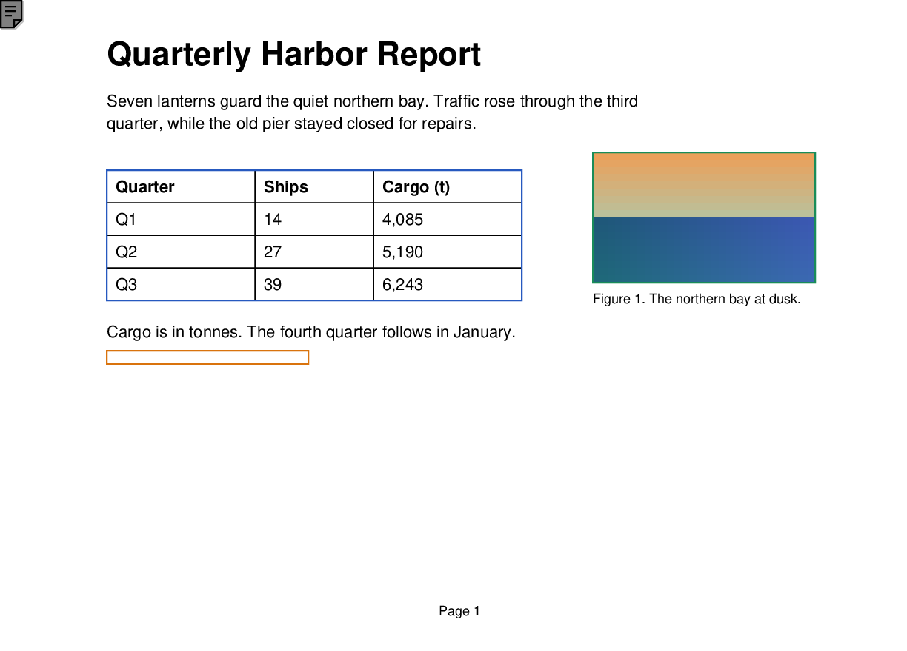

# ethos-parser

**Document parsing you can check.** ethos-parser turns PDFs, office files and scans into Markdown,
HTML and JSON. Every character points back to where the file drew it, and every gap it could not
read is reported, not hidden. Built for RAG and for any document where a citation has to hold up:
contracts, filings, reports.

**No AI model in the engine · Runs offline · Byte-identical on Linux, macOS and Windows ·
Apache-2.0, no AGPL**



*The overlay of [`docs/sample.pdf`](docs/sample.pdf): the table it found (blue), the image (green),
and a line drawn invisible (orange). The record flags that line, and `--drop-hidden` leaves it out
of the Markdown and counts it.*

## Try it in 30 seconds

**1. Install** on macOS or Linux. For Windows, see [`docs/INSTALL.md`](docs/INSTALL.md).

```bash
curl -fsSL https://raw.githubusercontent.com/docushell/ethos-parser/main/install.sh | sh
```

The script picks your platform's archive from the latest release, checks it against
`SHA256SUMS.txt`, checks the binary starts, and installs the binaries into `~/.local/bin`. Nothing
is installed if either check fails. If `~/.local/bin` is not on your `PATH`, the script prints the
line that adds it. The commands below use [`jq`](https://jqlang.org) to pull fields out of the
JSON.

**2. Get the sample page:**

```bash
curl -fLO https://raw.githubusercontent.com/docushell/ethos-parser/main/docs/sample.pdf
```

**3. Run it:**

```bash
# Markdown, with a map from every character back to the page
ethos-parser markdown --source sample.pdf | jq -r .markdown

# The same, with the invisible line left out and counted
ethos-parser markdown --source sample.pdf --drop-hidden | jq .coverage.dropped

# A copy of the PDF with what was found drawn on it
ethos-parser overlay sample.pdf > overlay.pdf

# A scan or a photo of a page: read by the bundled recognizer, on your machine
ethos-parser markdown --source scan.pdf --ocr | jq -r .markdown
```

## Plug it into your stack

| You are building | Start with |
| --- | --- |
| A pipeline or a script | The CLI, as above. `ethos-parser <command> --help` describes every flag |
| An agent in Claude Code | `claude mcp add ethos-parser -- "$(command -v ethos-parser)" mcp`, with `ethos-parser` on your `PATH` |
| A Python app (3.10+) | `pip install "git+https://github.com/docushell/ethos-parser#subdirectory=packages/python"` |
| A Node app (18+) | `git clone --depth 1 https://github.com/docushell/ethos-parser && npm install ./ethos-parser/packages/node` |
| From source | `cargo build --release --locked` |

The Python and Node packages call the `ethos-parser` binary, so install it first. Both ship
LangChain tools behind an optional install: see [`packages/python/`](packages/python/) and
[`packages/node/`](packages/node/).

## Why ethos-parser

- **Citations you can check.** Every text run carries a locator: page and position in a PDF; part,
  paragraph and run in Word; sheet, row and column in a spreadsheet. Markdown and HTML come with an
  anchor map, so a checker can reject a quote that touches text the exporter added rather than the
  document.
- **Gaps are reported, not hidden.** Text it could not decode, text drawn invisible, items with no
  box: each becomes a named limitation or a counted gap. Nothing is dropped silently.
- **Nothing invented.** The engine never makes up a table cell, a coordinate, an id or a page
  number. A `.docx` has no pages, so it gets no page number rather than a guessed one.
- **Deterministic.** There are no floating-point numbers in the JSON it writes. A release ships
  only when the Linux, macOS and Windows binaries write identical bytes for the gate documents.
- **Offline.** The engine and `--ocr` make no network calls and send no telemetry. The engine uses
  no AI model; `--ocr`'s neural networks are built into `ethos-parser-ocr`, so nothing is
  downloaded. The one exception is opt-in: the assist lane talks to a model server you name.
- **Formats read from the bytes.** PDF, DOCX, XLSX, PPTX, ODT, ODS, ODP, RTF and EPUB, plus PNG and
  JPEG with `--ocr`. The file name is never consulted.
- **Layout.** Reading order across columns, headings, lists, tables split across pages, strikeout
  and underline, running heads and page numbers, and pages drawn sideways or upside down.
- **A licence you can approve.** Apache-2.0, and every dependency is under a permissive licence.
  For the engine, the recognizer and the assist binary, `deny.toml` enforces that, and CI proves
  the rule fires by flipping a crate to AGPL and requiring the build to reject it.

## Benchmarks

Measured on `0f6c8a3` with each benchmark's own scorer, as its leaderboard is scored today. Higher
is better.

| Benchmark | ethos-parser | + `--ocr` | + assist model |
| --- | ---: | ---: | ---: |
| [ParseBench](https://github.com/run-llama/ParseBench), ~2,000 pages, overall | 52.14 | 54.69 | 65.34 |
| [ParseBench-2](https://huggingface.co/datasets/llamaindex/ParseBench-2), ~4,300 pages, overall | 55.22 | 57.15 | — |
| [opendataloader-bench](https://github.com/opendataloader-project/opendataloader-bench), 200 PDFs, overall | 0.813 | — | — |

- **ethos-parser** is the engine alone, with no OCR and no model. This project measured it; it is
  not on any of the three benchmarks' published lists. Placed among them, it would be 113th of 158
  on ParseBench's leaderboard, 54th of 57 on ParseBench-2's, and 9th of the 13 engines in
  opendataloader-bench's table. Higher on both ParseBench sets: parsers that use AI models, hosted
  or local. Higher on opendataloader-bench: eight engines, with and without models.
- **+ `--ocr`** adds the bundled recognizer for scanned pages: neural networks that run on your
  machine.
- **+ assist model** adds LightOnOCR-3-0.8B, a model you run, scored as the product writes it,
  inside its *Proposed* label. The model on its own scores 74.56 on ParseBench's leaderboard. The
  product scores less: ParseBench reads no table or title inside a quote, and where the engine read
  enough of a page the product keeps the engine's text, adding only the model's tables and charts.

The ranked tables, each benchmark's pinned commit and how to reproduce every number are in
[`docs/BENCHMARKS.md`](docs/BENCHMARKS.md).

## Commands

| Command | What it does |
| --- | --- |
| `extract` | The document as text runs with locators. `--ocr` reads scans and images; `--assist` asks a model you run |
| `markdown` | Markdown plus its anchor map, from a record or straight from a file with `--source` |
| `html` | HTML from a record `extract` wrote, with the same anchor map, keeping merged table cells |
| `elements` | One list of text, headings, page headers and footers, tables and pictures, each with its page and box |
| `locate` | Every place a string occurs, as node ids, offsets and boxes |
| `classify` | Counts and reason codes: is it scanned, is the layout hard |
| `overlay` | An annotated copy of the PDF: what was found, and a count of what has no box |
| `ground` | A record turned into `ethos.grounding.v1`, the citation format |
| `grounding-check` | Checks a grounding file's structure and its link to the source bytes |
| `verify` | Hands a citation check to the pinned Ethos verifier and relays its answer |
| `tag` | A copy of an untagged PDF with a structure tree written in, marked as computed |
| `mcp` | `extract`, `ground`, `node_get`, `locate` and `markdown` served to an agent over stdio |

Exit codes always mean the same thing: **0** it worked, **1** it ran and the answer is no, **2** it
could not run. `--diagnostics` adds timing to stderr; stdout never changes.

## What the output looks like

A text run and its locator:

```json
{
  "id": "s1",
  "kind": "text_run",
  "text": "Measured",
  "native_locator": {
    "pdf": { "page": 1, "origin_x": 7200, "origin_y": 7200, "advance": 9600 }
  }
}
```

Coordinates are whole centipoints, so `7200` means 72 pt.

Markdown and its anchor map:

```json
{
  "markdown": "Measured\n",
  "anchor_map": {
    "segments": [
      { "start": 0, "end": 8, "kind": "source", "node_ids": ["s1"] },
      { "start": 8, "end": 9, "kind": "syntax" }
    ]
  }
}
```

Every byte is the document's own text (`source`), syntax the exporter added (`syntax`), or, with
the assist lane, a model's text (`proposed`). **A quote that touches anything but `source` bytes is
not a citation.**

## Scans and the assist lane

**`--ocr`** runs the recognizer in `ethos-parser-ocr` on your machine: PP-OCRv5's detection and
recognition networks and an orientation classifier, built into the binary. It reads scanned pages,
PNG and JPEG, and stands a sideways or upside-down scan upright first. On x86-64 it
needs AVX2 and FMA. Scope: [`docs/35-OCR-SCOPE.md`](docs/35-OCR-SCOPE.md).

**The assist lane** is opt-in. A model server you run reads the pages you choose. Its text reaches
Markdown and HTML inside a block labelled *Proposed*, never as evidence and never citable. No assist
model ships; setup is in [`assist/README.md`](assist/README.md).

## What it will never do

- Emit a confidence score, a grade, or any single field meaning "this document is good."
- Delete hidden text, headers, footers or anything else without saying so.
- Invent a coordinate, an id, a fingerprint or a page number.
- Verify a citation itself. It checks structure and relays a verifier's answer.

## Where things stand

Version 0.66.0-dev.1. PDF and eight office formats read; Markdown, HTML, MCP and both SDKs ship.
The full inventory of what this build can and cannot do is [`docs/CAPABILITY.md`](docs/CAPABILITY.md).

## Tests and contributing

```bash
cargo test --workspace --locked   # nothing skipped; the oracle test needs the Ethos repo
bash ci/gate.sh                   # the whole gate, exactly as CI runs it
```

Every commit needs a `Signed-off-by` trailer. Run `git config core.hooksPath .githooks` once and
the tracked hooks add and check it. Start with [`docs/README.md`](docs/README.md).

## Licence

Apache-2.0. `NOTICE` records the encoding data, models and dependencies that ship. No AGPL
dependencies: `deny.toml` enforces it for the engine, the recognizer and the assist binary, and CI
proves the rule fires.
